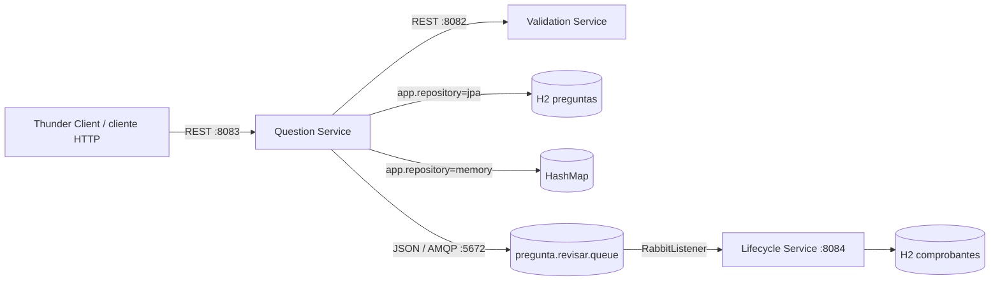

# Banco de Preguntas Saber PRO — Taller 13

Entrega final integradora, Fase II. Universidad del Cauca · Laboratorio de Ingeniería de Software II · 2026.2. Docente: Paola Andrea Bedoya Toro.                               
link drive video y tarea :https://drive.google.com/drive/folders/1alyzeld24jZVKon68a8SCk9uOvcrUVBc?usp=sharing

Evolución del [Taller 12](docs/taller12/README.md): conserva el agregado, las invariantes, los objetos de valor, los repositorios JPA/HashMap y sus pruebas. Añade tres microservicios, validación REST, eventos RabbitMQ reales, Docker Compose y pruebas de integración. El estado y las limitaciones de la verificación están en el [informe de implementación](docs/INFORME_IMPLEMENTACION.md).

## Ejecutar desde un clon limpio

Requiere Docker Engine y Docker Compose v2 o superior, los puertos 8082–8084, 5672 y 15672 libres y acceso a Docker Hub/Maven Central en la primera construcción.

```bash
docker compose config --quiet
docker compose up -d --build
docker compose ps
docker ps
docker compose logs -f question-service lifecycle-service
```

Cada Dockerfile compila su JAR dentro de una etapa Maven/Java 17. No requiere `target/` previo ni Maven en el anfitrión. Esperar a que los cuatro servicios indiquen `healthy`; también puede usarse `docker compose up -d --build --wait`.

| Servicio | Dirección | Función |
|---|---|---|
| Validation | http://localhost:8082 | Validación técnica síncrona |
| Question | http://localhost:8083/api/preguntas | Crear, listar, consultar y enviar a revisión |
| Lifecycle | http://localhost:8084/api/revisiones | Consultar comprobantes de eventos procesados |
| RabbitMQ | localhost:5672 | Transporte AMQP |
| RabbitMQ Management | http://localhost:15672 | Cola y consumidores; desarrollo: `guest / guest` |

La imagen `openjdk:17-jdk-slim` de los PDF respondió `no such manifest` al comprobarla. Se usa [Eclipse Temurin 17 JDK](https://hub.docker.com/_/eclipse-temurin/tags?name=17-jdk-jammy), manteniendo `WORKDIR /app`, el JAR, `EXPOSE` y `ENTRYPOINT`. La etapa adicional Maven permite cumplir la construcción desde fuentes con un solo comando. Ver [decisiones y fuentes](docs/arquitectura/decisiones.md).

## Arquitectura y tecnologías

Java 17, Spring Boot 3.4.5 (conservado de Taller 12), Spring Web, Bean Validation, Spring Data JPA, H2, Spring AMQP, RabbitMQ `3-management`, Maven Wrapper 3.9.9 y JUnit 5.



Compose conecta los servicios a la red bridge `saberpro-net`. Question llama a `http://validation-service:8082`; ambos participantes AMQP usan `SPRING_RABBITMQ_HOST=rabbitmq`. `localhost` se usa para acceder desde el anfitrión y para las comprobaciones de salud dentro de cada contenedor.

[Diagramas C4 niveles 1–4 y secuencia](docs/arquitectura/diagramas.md) · [modelo y contratos](docs/arquitectura/arquitectura.md) · [trazabilidad y rúbrica](docs/arquitectura/trazabilidad.md).

## Estructura

```text
.
├── pom.xml                         # Agregador Maven de tres proyectos autónomos
├── mvnw / mvnw.cmd / .mvn/          # Wrapper Maven
├── docker-compose.yml
├── .dockerignore / .gitignore
├── validation-service/
│   ├── Dockerfile / pom.xml / mvnw
│   └── src/main/java/co/edu/unicauca/saberpro/validation/
│       ├── ValidationServiceApplication.java
│       └── api/
├── question-service/
│   ├── Dockerfile / pom.xml / mvnw
│   └── src/main/java/co/edu/unicauca/saberpro/question/
│       ├── QuestionServiceApplication.java
│       ├── domain/model/             # Pregunta y objetos de valor
│       ├── domain/exception/
│       ├── domain/ports/inbound/      # CrearPreguntaUseCase, EvaluarPreguntaUseCase
│       ├── domain/ports/outbound/     # Persistencia, notificación, validación
│       ├── application/              # QuestionApplicationService
│       ├── infrastructure/           # jpa, memory, messaging, validation, config
│       └── api/                      # QuestionRestController
├── lifecycle-service/
│   ├── Dockerfile / pom.xml / mvnw
│   └── src/main/java/co/edu/unicauca/saberpro/lifecycle/
│       ├── LifecycleServiceApplication.java
│       ├── messaging/                # QuestionReviewListener
│       ├── application/ / persistence/
│       └── api/
├── scripts/                          # Verificación y pruebas HTTP reales
└── docs/
    ├── guias/                        # Dos PDF oficiales sin modificaciones
    ├── arquitectura/                 # C4, secuencia, decisiones, trazabilidad
    ├── pruebas/                      # Colección importable en Thunder Client
    ├── evidencias/                    # Resultados ejecutados, logs y checklist
    └── taller12/                     # Documentación original preservada
```

Cada servicio tiene sus pruebas en `src/test/java`. Las capturas originales siguen en `docs/figurasYEvidencias/` y corresponden exclusivamente al Taller 12.

## DDD, puertos y adaptadores

`Pregunta` es la raíz del agregado. `Enunciado`, `Justificacion` y `OpcionRespuesta` son records inmutables en `domain.model`. El dominio y el servicio de aplicación usan solamente Java; no tienen anotaciones Spring/JPA/AMQP.

- Enunciado obligatorio, texto de opción obligatorio y justificación de al menos 15 caracteres después de quitar espacios de los extremos.
- Toda creación inicia en `BORRADOR`. Conservando Taller 12, un borrador puede tener opciones incompletas.
- Para pasar a `PENDIENTE_REVISION`: exactamente cuatro opciones y una correcta. Un segundo envío lanza `ReglaNegocioException`.
- Las listas son inmutables y los repositorios usan copias del agregado. Se rechaza una rehidratación inconsistente.
- Los errores del dominio se convierten en HTTP 400; los controladores no repiten las invariantes.

| Puerto | Implementación / responsabilidad |
|---|---|
| `CrearPreguntaUseCase` | `QuestionApplicationService`: crear, buscar y listar |
| `EvaluarPreguntaUseCase` | El mismo servicio evalúa preparación y solicita revisión; no califica respuestas |
| `PreguntaRepositoryPort` | `JpaQuestionAdapter` o `InMemoryQuestionAdapter` |
| `NotificacionRevisionPort` | `RabbitMQPublisher`, equivalente al `NotificacionPort` de la guía |
| `ValidacionContenidoPort` | `RestValidationAdapter` llama al servicio Validation |

JPA traduce mediante `QuestionRecord`, `OpcionEmbeddable` y `QuestionDomainMapper`. Ninguna entidad de persistencia se usa como agregado.

## API y ejemplos

| Servicio | Método y ruta | Respuestas |
|---|---|---|
| Question | `GET /api/preguntas` | 200, lista vacía o preguntas |
| Question | `POST /api/preguntas` | 201 + `Location`, 400 o 503 |
| Question | `GET /api/preguntas/{id}` | 200, 404; UUID inválido: 400 |
| Question | `POST /api/preguntas/{id}/enviar-revision` | 202, 400, 404 o 503 |
| Validation | `POST /api/validaciones/preguntas` | 200 `{valida:true,errores:[]}` o 400 |
| Lifecycle | `GET /api/revisiones` | 200, comprobantes persistidos |
| Lifecycle | `GET /api/revisiones/{preguntaId}` | 200 o 404 mientras no exista comprobante |
| Los tres | `GET /actuator/health` | 200 cuando están saludables |

```json
{
  "enunciado": "¿Qué permite la arquitectura hexagonal?",
  "justificacion": "Permite cambiar adaptadores sin modificar el dominio.",
  "opciones": [
    {"texto": "Desacoplar dominio e infraestructura", "correcta": true},
    {"texto": "Eliminar interfaces", "correcta": false},
    {"texto": "Acoplar el dominio a JPA", "correcta": false},
    {"texto": "Eliminar pruebas", "correcta": false}
  ]
}
```

```bash
curl -i http://localhost:8083/api/preguntas
curl -i -X POST http://localhost:8083/api/preguntas \
  -H 'Content-Type: application/json' --data-binary @ejemplo-pregunta.json
# Sustituir UUID_GENERADO por el id de la respuesta anterior:
curl -i http://localhost:8083/api/preguntas/UUID_GENERADO
curl -i -X POST http://localhost:8083/api/preguntas/UUID_GENERADO/enviar-revision
curl -i http://localhost:8084/api/revisiones/UUID_GENERADO
```

La respuesta mantiene el contrato del Taller 12: `id`, `estado`, `enunciado: {"texto":"..."}`, `justificacion: {"texto":"..."}` y `opciones`. La entrada recibe los textos como cadenas. El envío ahora responde **202** (Taller 12 respondía 200).

Validation comprueba la estructura y límites técnicos: enunciado/justificación de hasta 4000 caracteres y texto de opción de hasta 2000, coherentes con las columnas JPA originales. No decide la cardinalidad de opciones, la clave correcta, la longitud mínima de justificación ni los estados. Esos límites técnicos son una decisión de implementación, no un requisito adicional atribuido a la docente.

## RabbitMQ y consistencia

Se declara la cola durable `pregunta.revisar.queue` en productor y consumidor. El productor envía JSON persistente al exchange por defecto con la cola como routing key; espera publisher confirm positivo y comprueba que el mensaje no fue devuelto por falta de ruta. Un fallo o timeout produce **503**, nunca 202.

La revisión bloquea la actualización, valida el agregado, guarda, publica y confirma la persistencia local. JPA utiliza transacción y bloqueo pesimista; HashMap utiliza exclusión mutua y restauración de la copia anterior. Una publicación fallida revierte a `BORRADOR`. Los envíos concurrentes se serializan.

No hay transacción distribuida ni Outbox: un ACK perdido puede dejar el resultado de publicación incierto; un fallo después del ACK y antes del commit puede dejar un evento sin cambio persistido. El `eventId` estable y los comprobantes persistentes en Lifecycle evitan repetir el procesamiento durante reintentos, pero no eliminan esa ventana. Ver [límites de atomicidad](docs/arquitectura/decisiones.md).

`QuestionReviewListener` consume con `@RabbitListener`, registra `preguntaId` y `eventId`, y confirma el mensaje tras persistir el comprobante. Reintenta fallos hasta tres veces. Los contratos inválidos o errores agotados van a `pregunta.revisar.queue.dlq` mediante `pregunta.revisar.queue.dlx`; no se reencolan indefinidamente.

## Persistencia e intercambiabilidad

Por defecto `app.repository=jpa`. En Compose, H2 guarda archivos en volúmenes distintos: `question-data` y `lifecycle-data`. RabbitMQ conserva su información en `rabbitmq-data`. Fuera de Compose, la configuración por defecto usa H2 en memoria.

Con el ecosistema iniciado:

```bash
APP_REPOSITORY=memory docker compose up -d --no-deps --force-recreate question-service
python3 scripts/smoke_test.py --label memory

# Volver a JPA conservando sus datos anteriores:
APP_REPOSITORY=jpa docker compose up -d --no-deps --force-recreate question-service
```

La selección usa beans condicionados por `app.repository`. HashMap pierde sus preguntas al reiniciar y no comparte datos con JPA. Las dependencias JPA siguen incluidas en modo memory y H2 puede inicializarse, aunque las operaciones de preguntas usan exclusivamente HashMap. No se modifica ninguna línea del dominio para cambiar de repositorio.

## Compilación y pruebas

Para compilar en el anfitrión se necesita JDK 17 o superior. El wrapper descarga Maven 3.9.9. Con Maven instalado también puede utilizarse `mvn`.

```bash
./mvnw clean verify                  # Pruebas sin broker externo y tres JAR
./scripts/check-domain.sh            # Compila dominio/aplicación sin frameworks

# Pruebas de integración: requieren RabbitMQ, Validation y Lifecycle reales.
docker compose up -d --build --wait
./mvnw -Pintegration verify
python3 scripts/smoke_test.py --label jpa

# Incluye caídas y recuperación; detiene brevemente dependencias de este Compose:
python3 scripts/smoke_test.py --label jpa --faults --output docs/evidencias/smoke-local.json

# Flujo completo equivalente:
./scripts/verify.sh --output docs/evidencias/verificacion-local.json
```

Los `*IntegrationTest` se ejecutan con Maven Failsafe en el perfil `integration`; las pruebas habituales con Surefire. No se omiten silenciosamente: el perfil falla si las dependencias reales no están disponibles. Las seis pruebas HTTP originales fueron migradas conservando sus comprobaciones y ajustando solamente el contrato de revisión 200 → 202. Los tests de integración usan componentes reales; los dobles están limitados a pruebas unitarias.

Para empaquetar un servicio según la guía: `cd question-service && ./mvnw clean package -DskipTests`. Este comando omite pruebas por solicitud explícita; para verificar la entrega utilizar los comandos anteriores.

[Protocolo completo de pruebas](docs/pruebas/README.md) · [colección para Thunder Client](docs/pruebas/SaberPRO_Taller13.postman_collection.json).

## Ejecución Java local

Primero levantar dependencias; usar terminales distintas para los servicios que se ejecuten localmente. Evitar iniciar dos procesos sobre el mismo puerto.

```bash
./mvnw clean package
# Dependencia AMQP para ejecución local:
docker compose up -d rabbitmq
java -jar validation-service/target/validation-service-2.0.0.jar
java -jar lifecycle-service/target/lifecycle-service-2.0.0.jar
java -jar question-service/target/question-service-2.0.0.jar --app.repository=jpa
```

`VALIDATION_SERVICE_URL`, `SPRING_RABBITMQ_HOST`, `SPRING_RABBITMQ_PORT`, `APP_REPOSITORY` y `DB_URL` permiten configurar los adaptadores. Las URLs y timeouts no pertenecen al dominio.

## Solución de problemas

| Síntoma | Comprobación / solución |
|---|---|
| Puerto ocupado | Identificar el proceso con `docker ps`/herramientas del sistema y detener únicamente el despliegue propio que corresponda |
| 503 al crear | Revisar `docker compose logs validation-service question-service`, conectividad y `VALIDATION_SERVICE_URL` |
| 503 al revisar | Revisar salud de RabbitMQ, logs, cola y credenciales; consultar estado antes de reintentar |
| 400 al revisar | Verificar cuatro opciones, una correcta y estado BORRADOR |
| Cola sin mensajes visibles | El consumidor puede vaciarla inmediatamente; revisar consumidor, logs y `/api/revisiones/{id}` |
| Mensaje inválido | Inspeccionar `pregunta.revisar.queue.dlq` y el contrato v1 antes de reintentarlo |
| Pruebas de integración fallan por conexión | Iniciar Compose y esperar `healthy`; las pruebas no usan brokers simulados |
| Imagen de la guía no existe | Usar los Dockerfile entregados con Temurin 17; no sustituir por una versión incompatible de Java |
| Poco espacio / descarga interrumpida | Revisar `df -h` y `docker system df`; reintentar después de liberar espacio bajo control del propietario |
| Datos desaparecen en memory | Es el comportamiento esperado del HashMap; elegir JPA con su volumen para persistencia |

Para detener sin borrar datos: `docker compose stop`. `docker compose down` retira los contenedores y conserva los volúmenes; no usar `-v` si se desea conservar la información.

## Entregables

Los dos PDF están en `docs/guias/`. El [informe técnico](docs/INFORME_TECNICO.md), los C4, la matriz y las evidencias textuales acompañan el código. La plantilla institucional `Formato-Documento.docx` no fue proporcionada: queda trasladar el informe a esa plantilla y tomar las capturas indicadas en [evidencias](docs/evidencias/README.md). La publicación en GitHub queda a cargo del propietario después de revisar los cambios.
